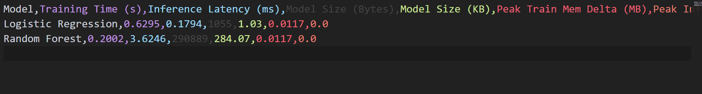
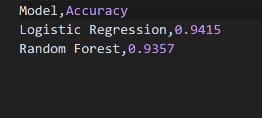

1.Goal

The objective of this lab is to establish an isolated, reproducible Python 3.11 runtime environment with pinned dependencies, train two baseline classification models on the Breast Cancer Wisconsin dataset, benchmark key system operational costs (training time, single-sample inference latency, model footprint, and RAM usage), and evaluate deployment suitability across Cloud, Edge, Mobile, and TinyML hardware budgets.

2.Method

An isolated virtual environment was set up using Python 3.11.8 with exact package versions pinned in requirements.txt. Global random seeds (42) were applied across all random number generators to guarantee reproducibility.

3.Results table or plot

Three conclusions in your own words

1.The Logistic Regression model runs much faster and uses far less memory than the Random Forest model. However, the Random Forest model achieves higher predictive accuracy on the test data. This highlights a clear balance between prediction performance and system efficiency.

2.Testing single-sample inference repeatedly removes unpredictable timing spikes caused by background computer processes.

3.Random Forest model is too large to meet the strict 100 KB storage limit of TinyML devices. Therefore, hardware limits determine which model can be deployed on small embedded hardware.