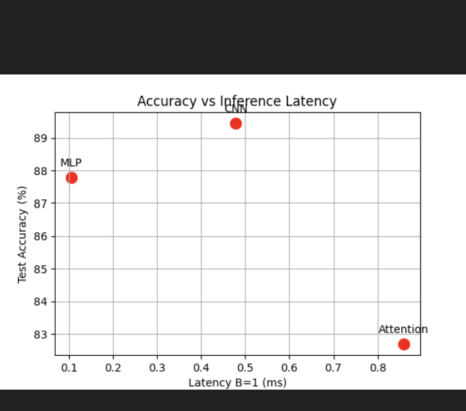
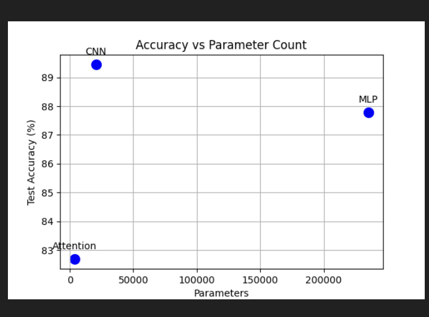

1. Goal
The objective of this lab is to construct three distinct neural network architectures (Multi-Layer Perceptron, Convolutional Neural Network, and Vision Transformer Attention network) in PyTorch within a budget of 100k to 150k parameters using Fashion-MNIST. The lab evaluates hand-calculated theoretical FLOPs against profiler outputs, measures batch latency, and analyzes trade-offs between parameter efficiency and computational cost.  

2. Method
We took thousands of pictures of clothes like shirts and shoes, split them into groups for learning and testing, and built three different types of computer models to recognize them: a standard network, a grid-scanning picture network, and a smart attention network. We counted how many math operations each model needed by doing calculations on paper and comparing them with automatic measuring software, ran tests to see how fast each model worked with single pictures versus big groups, and finally trained all three models for five rounds to compare how accurate and fast they were.
3.  Results

4. Conclusions

Discrepancies between hand calculations and thop measurements occur

The CNN achieved the highest test accuracy  while using significantly fewer parameters

The Attention architecture exhibited the highest inference latency (4.82 ms at batch 128) due to quadratic sequence self-attention operations and memory-bound matrix transpose and reshape operations compared to dense linear matrix multiplications.