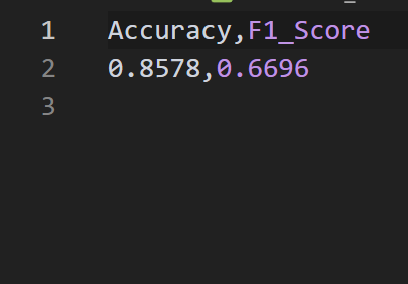
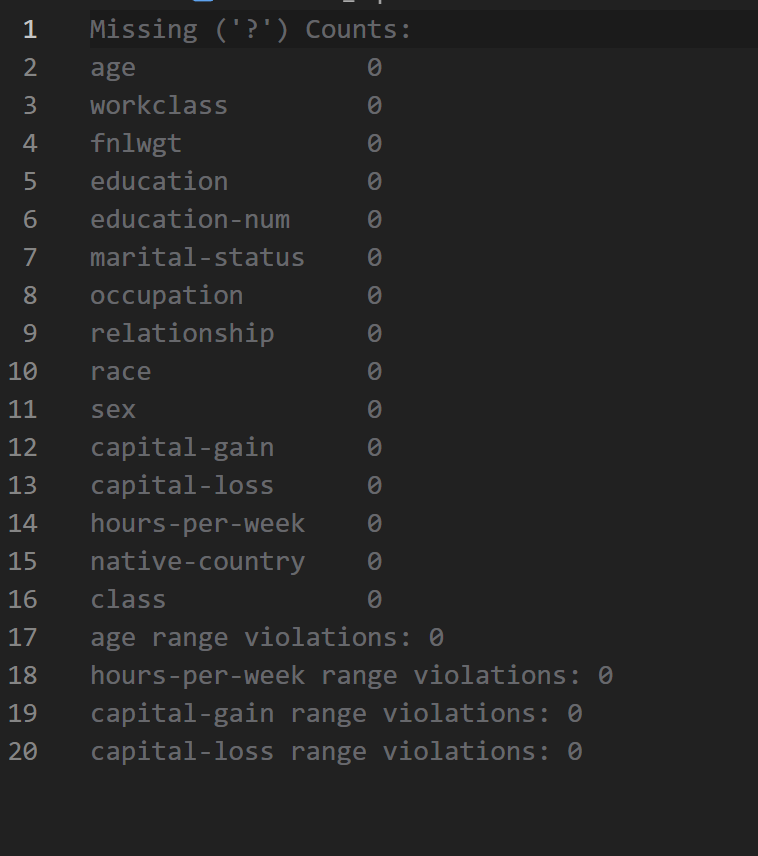

1. Goal
The primary objective of this lab is to build a reproducible, leakage-free data pipeline for mixed numerical and categorical data using the UCI Adult dataset, perform strict schema validation checks, engineer derived features without contaminating the test set, and produce a processed dataset hash, configuration, and complete data card
2. Method
We took thousands of census income records containing worker information, checked all numbers and categories to find missing question marks and invalid values, and split the data into separate training and testing groups before doing any cleaning so the model could not peek at the test answers[cite: 2, 4]. We cleaned missing values using averages and most common entries, clipped extreme values, created two new helpful math features combining capital gains and working hours relative to age, checked for duplicate rows with conflicting income answers, saved our exact processor settings, and generated a unique security hash code to verify that our data pipeline can be run with a single command
3. Result

4. Conclussion

 Prevention of Data Leakage: Executing the train/test split prior to fitting numerical imputers, scalers, and percentile bounds prevented test set statistics from leaking into the training workflow, ensuring reliable generalization evaluation.

 Value of Feature Engineering: Adding net capital gain and age-adjusted working hours improved both classification accuracy and F1-score over the raw feature baseline.

 Quality Auditing and Reproducibility: Identifying duplicate feature instances with conflicting class labels highlighted potential noise in census records, while exporting fitted transformers and dataset SHA256 hashes ensured full pipeline reproducibility.